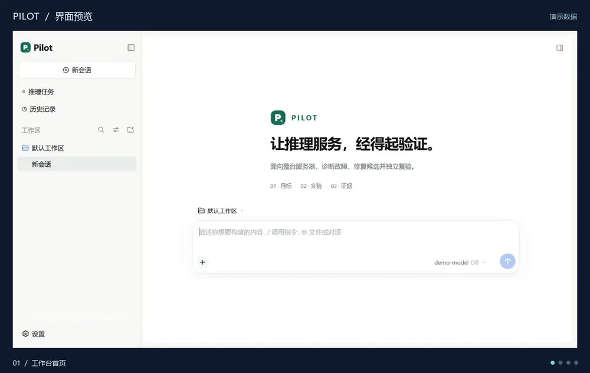

# Pilot

Pilot 是一个面向推理服务交付的 AI Infra 工作台。它将服务器资源检查、部署方案、模型服务测试和故障修复串成一个可追踪的任务：用户提出目标，Pilot 组织执行，并用实际测试结果交付报告。



## 项目现状

当前版本为 **0.11.0**，项目处于开发和验证阶段。已有单节点推理任务、服务器与资产管理、源码工作区、任务控制和独立验收；不同硬件和引擎的可用范围取决于对应配方与实际环境。

| 范围 | 当前状态 |
| --- | --- |
| 单节点推理 | 支持登记 SGLang/vLLM 模型和镜像，按受限配方部署、测试、诊断及回滚；已有特定模型和设备的小规模验证。 |
| 多节点管理 | 支持分别管理节点、资产和任务，也支持 2～4 个节点之间的有界 TCP 链路检查。 |
| 软件与算子 | 支持节点源码工作区、固定检查和 CPU profiling；CUDA RMSNorm 和同机 1P1D 有限定范围的实验。 |
| 跨机 PD / Ray | 已有两节点拓扑草稿和静态预检，CPU Ray 双机原型经过实验；正式跨机执行、GPU 调度和在线 KV 传输尚未完成。 |
| 待完善 | 通用 GPU 热点分析与算子优化、更多加速平台、多卡及长期稳定性验证。 |

## 业务功能


| 业务 | 在 Pilot 中怎么做 | 产出 |
| --- | --- | --- |
| 服务器与资产 | 登记节点，观察 GPU、CPU、内存、磁盘和 Docker；管理节点上的模型、镜像和执行器。 | 资源观测、资产状态和任务可用范围。 |
| 部署并验证 | 选择节点、模型和镜像，填写负载与资源需求，保存并审阅方案后启动任务。 | 服务状态、质量探针、延迟和吞吐结果。 |
| 诊断并修复 | 从已有部署任务读取失败日志和证据，在允许的配置、请求适配或登记源码范围内修复。 | 新的冻结候选、修复记录和复验结果。 |
| 回归比较 | 在相同模型、设备和负载协议下，依次测试两个候选。 | 质量、TTFT、吞吐和失败情况的对照。 |
| 软件与算子工作区 | 在选定节点准备专属工作区，编辑源码并运行登记的构建、测试或 profiling 配方。 | 候选源码、构建日志、检查结果和可下载的证据。 |
| 多节点链路 | 选择节点和接口，保存网络检查方案；跨机 PD/Ray 可另外填写拓扑并做静态预检。 | 双向链路检查结果，或拓扑预检中的问题与待办。 |

部署、诊断、比较和实验共用同一套任务、候选和验收机制。短质量探针与有限负载测试用于检查当前任务，不代表完整的模型准确率或长期稳定性评测。

## 核心设计


会话与工具运行时负责交互和协作，Pilot 围绕资源、任务、执行和验收组织业务：

- **Pilot 主控**理解目标、生成方案，并根据当前证据决定下一步。
- **Infra 专家**处理环境、资源与服务问题；**Repo 专家**处理获准范围内的源码和请求适配。专家按需参与，主控汇总结果。
- **领域服务与执行器**保存任务状态、候选、操作和资源范围，在节点的专属目录或容器中执行配方。
- **独立验收**核对当前服务与候选身份，并运行质量和性能检查；启动成功或模型回复不能单独作为交付结论。

一个任务可以包含多个不可变候选和多次 Job。遇到断连或结果未知时，先核对原操作，再决定恢复、停止或继续。更详细的模块关系见 [架构说明](docs/ARCHITECTURE.md) 和 [架构图册](docs/PILOT_ARCHITECTURE_MAP.md)。

## 快速开始

需要 Python 3.11+、Node.js 24.9+ 和 npm。Windows 下在 PowerShell 中执行：

```powershell
git clone https://github.com/271278430/pilot_agent.git
cd pilot_agent
python -m venv .venv
.\.venv\Scripts\Activate.ps1
New-Item -ItemType Directory -Force .cache/build | Out-Null
python -m pip install -r requirements.lock -e '.[dev]'
npm ci --prefix harness/runtime --no-audit --no-fund
.\启动Pilot.cmd
```

启动后在浏览器打开 `http://127.0.0.1:18900`。首次使用时，在「设置 → 工作区与模型」选择可用模型，测试、保存并同步。

<details>
<summary>Linux 安装与启动</summary>

```bash
git clone https://github.com/271278430/pilot_agent.git
cd pilot_agent
python3 -m venv .venv
source .venv/bin/activate
mkdir -p .cache/build
python -m pip install -r requirements.lock -e '.[dev]'
npm ci --prefix harness/runtime --no-audit --no-fund
python -m pilot_host.cli --port 18888
```

另开一个终端，在项目目录运行 `.venv/bin/python scripts/local_entry.py --root . --port 18900`，然后打开 `http://127.0.0.1:18900`。

</details>

### 示例：先制定部署方案

1. 在「推理任务 → 服务器与权限」添加目标节点并查看整机观测，在「模型与镜像」准备任务使用的资产。
2. 新建会话，输入：

   > 查看目标节点的 GPU、内存和磁盘，为已登记的 Qwen3 和 SGLang 制定部署与验收方案。输入长度使用 128 和 1024，并发使用 1 和 2；先保存草稿，等我审阅。

3. 在「推理任务」查看草稿中的节点、模型、资源、负载和预算；需要调整时编辑方案，再点击「开始任务」。
4. 完成后查看任务中的服务状态、成功请求数、TTFT、端到端延迟、输出 token/s 和独立验收结果，并下载报告。

如果已有部署出现异常，可在该任务对话中要求 Pilot 读取失败日志、分析原因并提出修复；修复后会生成新候选，再按相同协议复验。

## 代码与测试

主要实现位于 `src/pilot_host`、`src/pilot_infra` 和 `harness/runtime/plugins`；自动化测试位于 `tests`。运行完整回归：

```bash
python scripts/full_project_check.py
```

业务入口和操作步骤见 [使用指南](docs/CURRENT_GUIDE.md)，测试脚本与业务映射分别见 [测试目录](tests/FULL_TEST_CATALOG.md) 和 [业务测试对应表](tests/BUSINESS_TEST_MATRIX.md)。

<details>
<summary>项目目录与根目录文件</summary>

| 位置 | 内容 |
| --- | --- |
| [.github](.github/README.md) | CI 配置。 |
| [docker](docker/README.md) | 隔离执行环境的镜像定义。 |
| [docs](docs/README.md) | 架构、使用和开发文档。 |
| [evals](evals/README.md) | 评测协议与公开测试素材。 |
| [harness](harness/README.md) | Harness 运行时配置与项目插件。 |
| [prompts](prompts/README.md) | 主控与专家的提示词。 |
| [scripts](scripts/README.md) | 启动、测试和文档生成脚本。 |
| [skills](skills/README.md) | 主控与专家的任务技能。 |
| [src](src/README.md) | Host、业务服务、执行器与验收实现。 |
| [tasks](tasks/README.md) | 开发状态与任务示例。 |
| [tests](tests/README.md) | 回归测试、夹具与业务映射。 |

`README.md` 是项目入口；`pyproject.toml` 定义 Python 包和命令；`requirements.lock` 锁定依赖；`setup.cfg` 指定构建目录；`.env.example` 与 `infra.env.example` 是配置模板；`.gitignore` 和 `.gitattributes` 管理 Git 文件；`启动Pilot.cmd` 与 `停止Pilot.cmd` 是 Windows 启停入口；`AGENTS.md` 是开发约定；`CHANGELOG.md` 记录版本；`THIRD_PARTY_NOTICES.md` 说明第三方来源。

每个目录中的 README 都列出该目录的文件与子目录。

</details>
