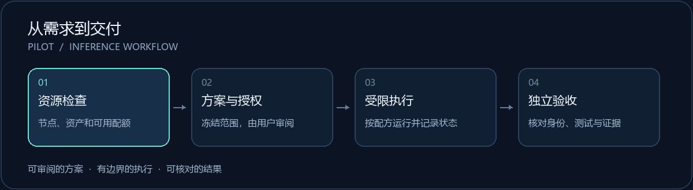
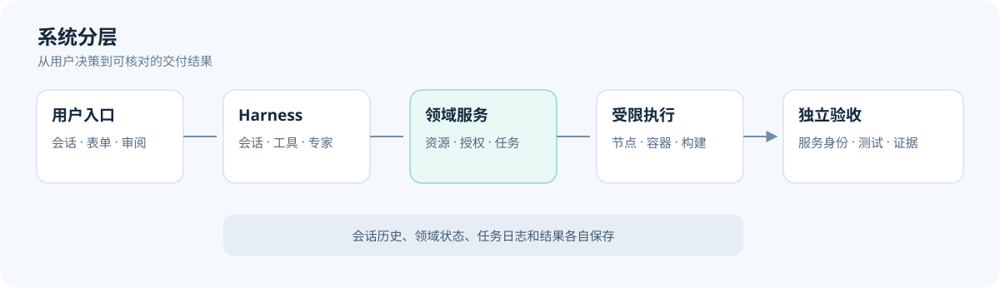

# Pilot

Pilot 是一个面向推理服务的 AI Infra 工作台：查看服务器资源，制定受限的部署方案，执行诊断和测试，并保留可核对的交付证据。



## 能做什么

| 场景 | 主要能力 |
| --- | --- |
| 服务器与资源 | 登记节点，检查硬件、存储和 Docker，管理模型、镜像和任务授权。 |
| 推理服务 | 保存和审阅方案，使用受限配方部署服务，收集日志并执行质量与性能测试。 |
| 诊断与修复 | 根据证据定位环境或源码问题，冻结候选版本，复验并按需回滚。 |
| 源码工作区 | 在隔离环境中编辑、构建并测试获准范围内的源码。 |
| Agent 协作 | 基于 DeepSeek Harness 的会话和工具机制，由主控按需调用 Infra 与 Repo 专家。 |

已有节点管理、单节点推理任务、独立验收及有界网络检查。跨机在线 PD、Ray 联合部署、通用 GPU 自动 profiling 和算子优化仍在开发；双机 CPU Ray 实验不代表 GPU 或跨机推理已通过。

## 工作方式



需求可以从会话或表单进入。方案保存后由用户审阅并启动；执行器按授权范围运行任务，验收结果与实际服务和候选版本绑定。执行结果未知时先核对原操作，再决定后续处理。

系统分层和数据流见 [架构说明](docs/ARCHITECTURE.md)，完整的模块图见 [架构图册](docs/PILOT_ARCHITECTURE_MAP.md)。

## 快速开始

需要 Python 3.11 或更新版本、Node.js 24.9 或更新版本和 npm。容器及 GPU 功能还需要相应的 Docker、驱动和已授权资源。

```powershell
git clone https://github.com/271278430/pilot_agent.git
cd pilot_agent
python -m venv .venv
.\.venv\Scripts\Activate.ps1
New-Item -ItemType Directory -Force .cache/build | Out-Null
python -m pip install -r requirements.lock -e '.[dev]'
npm ci --prefix harness/runtime --no-audit --no-fund
```

Windows 可双击 `启动Pilot.cmd`，然后访问 [http://127.0.0.1:18900](http://127.0.0.1:18900)。也可以直接运行 `python -m pilot_host.cli --port 18888`，按终端输出打开本机地址。模型连接通过界面配置；模板见 [.env.example](.env.example)。

服务器、凭据和任务权限需要在实际环境中登记。**不要把密钥、连接配置、工作区或运行日志提交到仓库。** 更多操作见 [使用指南](docs/CURRENT_GUIDE.md) 和 [数据与凭据管理](docs/SECURITY.md)。

## 测试

```powershell
python scripts/full_project_check.py
```

该入口检查 Python 和 Node 测试、插件语法、Ruff、业务映射及文档同源关系；报告写入本地 `reports/`。测试目录和业务映射分别见 [全量测试目录](tests/FULL_TEST_CATALOG.md) 与 [业务测试对应表](tests/BUSINESS_TEST_MATRIX.md)。需要特定平台、Docker 或 GPU 的检查会按环境条件运行或跳过。

## 目录

每个源码目录的 README 都列出直接子目录与文件。推荐从 [src](src/README.md)、[harness](harness/README.md)、[scripts](scripts/README.md) 和 [tests](tests/README.md) 开始阅读。

| 位置 | 内容 |
| --- | --- |
| [.github](.github/README.md) | CI 配置。 |
| [docker](docker/README.md) | 隔离运行环境的镜像定义。 |
| [docs](docs/README.md) | 架构、使用、开发与能力边界。 |
| [evals](evals/README.md) | 固定评测协议与公开测试素材。 |
| [harness](harness/README.md) | Harness 运行时配置及 Pilot 插件。 |
| [prompts](prompts/README.md) | 不同职责所用的提示词。 |
| [scripts](scripts/README.md) | 本地启动、检查、生成文档及受限运维脚本。 |
| [skills](skills/README.md) | 主控和专家的任务技能。 |
| [src](src/README.md) | Host、领域服务、执行器和验收实现。 |
| [tasks](tasks/README.md) | 开发状态与任务示例。 |
| [tests](tests/README.md) | 自动化回归与测试夹具。 |

根目录文件：`README.md` 是项目入口；`pyproject.toml` 定义 Python 包及入口；`requirements.lock` 锁定 Python 依赖；`setup.cfg` 指定构建元数据目录；`.env.example` 和 `infra.env.example` 是无密钥配置模板；`.gitignore` 与 `.gitattributes` 管理 Git 文件；`启动Pilot.cmd` 和 `停止Pilot.cmd` 是 Windows 启停入口；[AGENTS.md](AGENTS.md) 是开发约定；[CHANGELOG.md](CHANGELOG.md) 记录版本；[THIRD_PARTY_NOTICES.md](THIRD_PARTY_NOTICES.md) 说明第三方来源。
