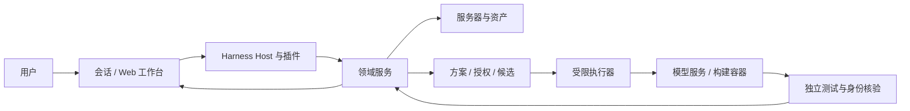

# 架构说明

Pilot 在 DeepSeek Harness 的 Session、Loop、工具、审批和子会话机制之上组织推理交付。项目自身负责业务状态、资源边界、任务执行和独立验收，不替代上游执行循环。

## 主要边界

| 层次 | 职责 | 代码 |
| --- | --- | --- |
| 入口 | 会话、任务面板、配置和用户操作 | `src/pilot_host`、`harness/runtime/plugins` |
| 领域 | 资源登记、权限、任务、预算、候选和证据 | `src/pilot_infra`、`src/pilot_core` |
| 执行 | 按已批准的配方使用节点、容器和任务目录 | `src/pilot_infra` 的 Worker 与执行后端 |
| 验收 | 核对当前服务、候选和测试结果 | `src/pilot_infra`、`src/pilot_eval` |
| 兼容业务 | 模型交付、应用、项目管理与独立实验入口 | `src/pilot_delivery`、`src/pilot_apps`、`src/pilot_projects`、`src/repopilot`、`src/infra_pilot` |

业务任务与 Harness 会话分别保存；任务结果不能仅凭模型回复判定。资源登记、访问核验、任务授权和真实验收是不同步骤。可交付范围和未完成项见 [能力边界](CAPABILITIES.md)，模块细图见 [架构图册](PILOT_ARCHITECTURE_MAP.md)。
