# Pilot 项目架构图

更新：2026-11-25；与 Web「设置 → 项目架构」来自同一目录。

Pilot检测已有服务器的环境和资源，按目标选择节点与配额，管理模型、镜像和节点数据目录，执行受限部署及独立验证。基于DeepSeek Harness的Session/Loop，主控Agent按需调用Infra/Repo软件subagent。当前支持多节点独立管理、软件/评测脚本/CPU profiling、CUDA RMSNorm及同机1P1D KV复用验证；已提供跨机PD/Ray拓扑草稿和静态预检；在线执行、Ray联合部署和GPU自动profiling仍待实现。保存方案不会自动执行。

系统总图与十个模块图。实线框标执行位置或外部依赖；虚线框标Session、文件或原生调用范围。颜色区分原生能力/Pilot业务程序，不表示数据可信或权限等级。

默认策略：auto。主控按需使用零位、一位或先后两位专家；最多一位活动专家。

## 项目总览

[项目总览](#system)

选择模块查看设计，再展开内部流程。

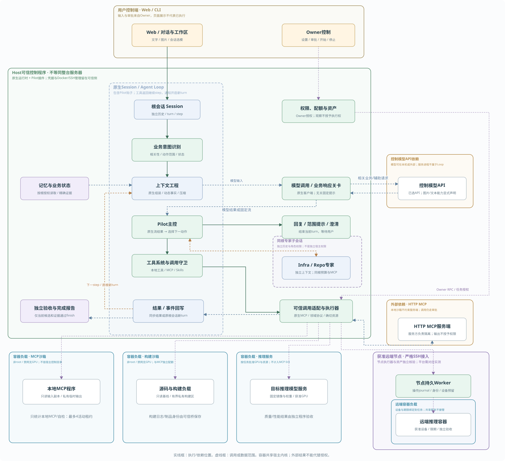

[打开完整SVG](architecture/system.svg)

图内边界：

- 用户控制端 · Web / CLI：输入与审批来自Owner，页面展示不代表已执行
- Host可信控制程序 · 不等同整台服务器：原生运行时 + Pilot插件；凭据与Docker/SSH管理留在可信侧
- 原生Session / Agent Loop：包含Pilot钩子；工具返回继续step，通知开启新turn
- 同根专家子会话：独立历史与角色权限；不是独立宿主权限
- 控制模型API依赖：模型可在本机或外部；服务进程不属于Loop
- 外部依赖 · HTTP MCP：本地沙箱不约束服务端；调用仍走审批
- 容器负载 · MCP沙箱：非root / 禁网无GPU；不挂宿主控制目录
- 容器负载 · 构建沙箱：非root / 禁网无GPU；与MCP独立配额
- 容器负载 · 推理服务：按任务批准GPU与资源；不计入MCP 0/4
- 获准远端节点 · 严格SSH接入：节点执行器与资产独立核验；平台需对应实测
- 远端容器负载：设备与期限绑定到任务；共享服务不接管

- 工作区、多模型目录和资源根属于Owner控制；模型与资源模块画出图片输入、会话选模、API和下载路径；权限图保留预算与审批。
- 执行隔离在权限模块展开：管理桥仍可信宿主程序，MCP/构建负载进容器；HTTP MCP另属外部服务边界。
- Host框表示可信控制程序的边界，不表示整台物理服务器；同机容器和本机控制模型服务仍是独立负载/服务进程。
- 节点颜色区分原生能力与Pilot业务程序；信任和作用域以框标题为准。GPU/构建容器不属于MCP 0/4配额。
- 范围关卡在原生llm/stream派发处短路：无关/不明确只产生固定程序回复，主控API不被调用；辅助分类仍按真实usage计量，历史上下文不以伪造零usage替代估算。

## 对话与控制入口

[项目总览](#system) → [对话与控制入口](#entry)

原生工作区选择、用户消息和Owner任务操作三条路径；工作区目录与领域执行目录明确区分。

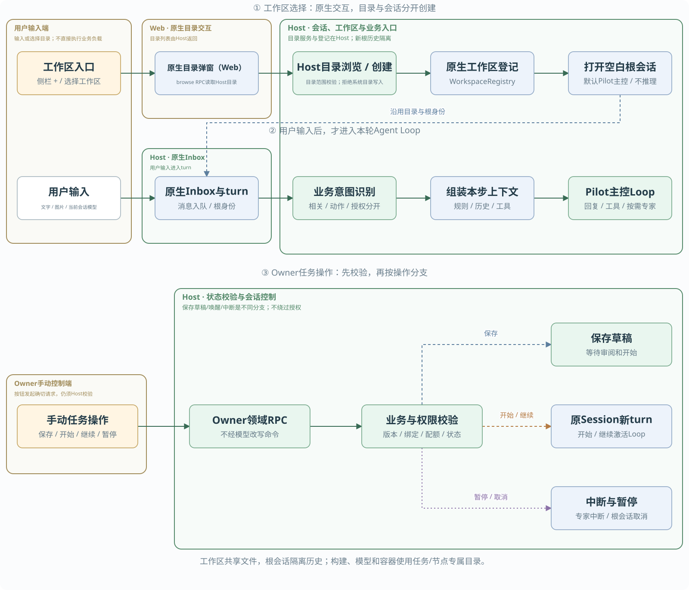

[打开完整SVG](architecture/entry.svg)

图内边界：

- 用户输入端：输入或选择目录；不直接执行业务负载
- Web · 原生目录交互：目录列表由Host返回
- Host · 原生Inbox：用户输入进入turn
- Host · 会话、工作区与业务入口：目录服务与登记在Host；新根历史隔离
- Owner手动控制端：按钮发起确切请求，仍须Host校验
- Host · 状态校验与会话控制：保存草稿/唤醒/中断是不同分支；不绕过授权

- 模块内部的简单流程合并在同一图中，不再逐层点击；可全屏、缩放、导出查看完整关系。
- 设置中可见完整服务器主目录并可修改；新建使用applied根，旧原生登记目录继续可访问，历史cwd不迁移。
- 原生目录弹窗在Web，browse RPC访问Host目录。复用原生组件不意味着整个目录功能运行在浏览器。
- 图片和会话选模使用原生入口；图片能力校验/持久保存和多模型配置在“模型与资源”图展开。

协作模块：

- [Agent Loop](#loop)：新推理需求激活原生主控
- [工具系统](#tools_system)：Owner RPC与模型工具共用领域校验
- [业务意图识别与路由](#intent_routing)：咨询、无关与不明确消息不创建草稿

## 模型、图片与资源路径

[项目总览](#system) → [模型、图片与资源路径](#model_access)

模型登记、原生会话选模与图片链路；受管下载路径同图展开。

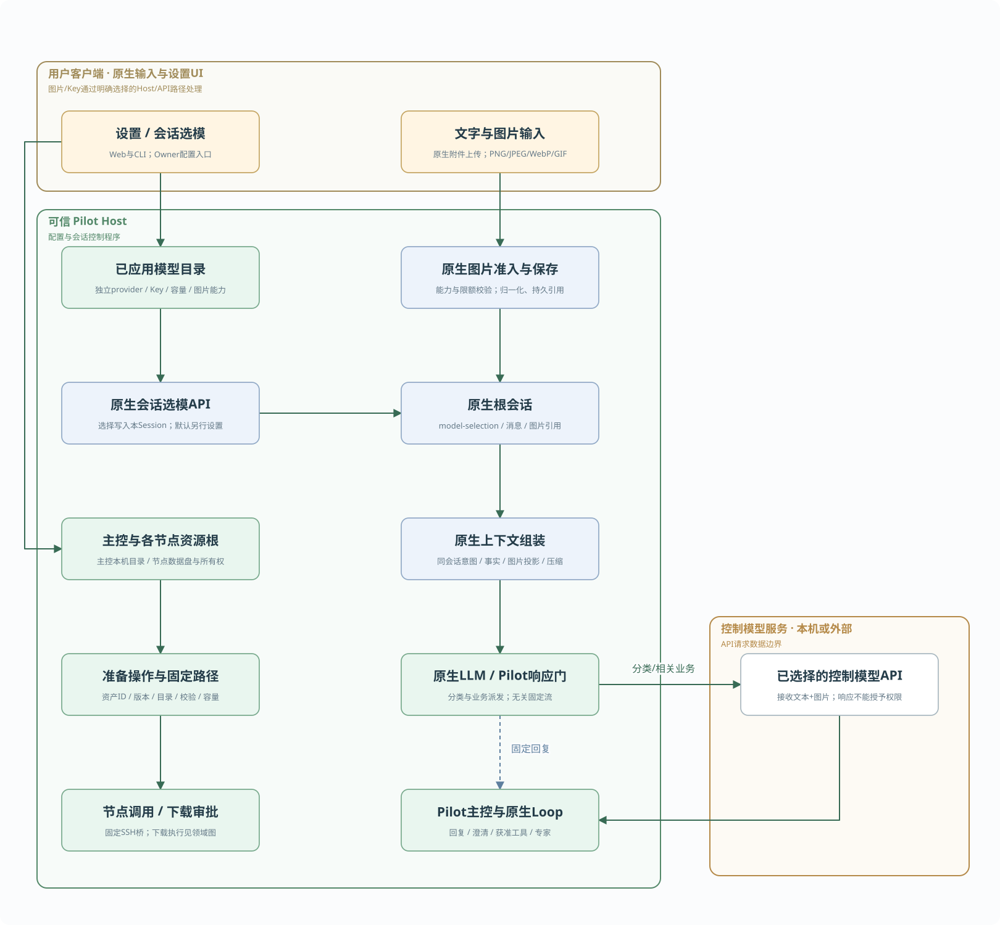

[打开完整SVG](architecture/model_access.svg)

图内边界：

- 用户客户端 · 原生输入与设置UI：图片/Key通过明确选择的Host/API路径处理
- 可信 Pilot Host：配置与会话控制程序
- 控制模型服务 · 本机或外部：API请求数据边界

- 模型目录最多16项；当前设置登记OpenAI兼容Chat Completions接口。保存/测试/同步前校验官方模型代码与思考兼容性，旧错误草稿仍可编辑；测试区分HTTP及白名单平台错误码，不回显返回体或自动切换Key/计费端点。配置声明图片能力不代表已实测识图质量。
- 会话选模不修改全局默认；专家按原生已记录请求继承模型。本次同步只更新选择该配置的会话ID/推理方式，不把其他会话切为默认。
- 纯图片先澄清目标，图片中指令不是执行授权；不同根不继承彼此图片。音视频和图片生成无专门支持。
- 下载路径快照与执行器/资产版本绑定；设置保存后空闲同步，既有资产不自动迁移。已登记节点目录需要在服务器与权限明确更新并重新核验。
- 模型输出、图片与下载源码均为数据；工具审批、资源额度、沙箱及独立验收仍按各模块执行。
- 范围关卡在原生llm/stream派发处短路：无关/不明确只产生固定程序回复，主控API不被调用；辅助分类仍按真实usage计量，历史上下文不以伪造零usage替代估算。

协作模块：

- [上下文工程](#context)：路由尺寸、压缩、计量与图片卸载
- [主控与专家协作](#collaboration)：当前模型的专家继承
- [领域执行与独立交付](#execution)：受管资产与容器交付
- [权限、预算与状态守卫](#governance)：预算与审批

## 业务意图识别与路由

[项目总览](#system) → [业务意图识别与路由](#intent_routing)

同一主控内的功能模块：先确定需求范围，再选择动作；后台任务通知沿原授权继续。

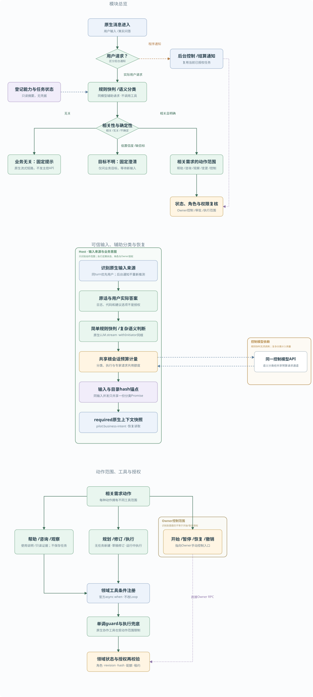

[打开完整SVG](architecture/intent_routing.svg)

图内边界：

- Host · 输入来源与业务意图：只识别动作范围；执行还需状态、角色与Owner授权
- 控制模型依赖：规则快判无须调用；复杂分类计入用量
- Owner控制范围：识别到意图仍不等于开始/恢复授权

- 无关会话不会修改业务状态或派专家；现有后台工作继续受原任务授权管理。
- 相关性与动作分类不是授权。人工开始、审批、配额与当前任务状态保持独立校验。
- 分类失败闭合为澄清；不把自然语言识别宣称永远正确。
- 模块内部的简单流程合并在同一图中，不再逐层点击；可全屏、缩放、导出查看完整关系。
- 范围关卡在原生llm/stream派发处短路：无关/不明确只产生固定程序回复，主控API不被调用；辅助分类仍按真实usage计量，历史上下文不以伪造零usage替代估算。

协作模块：

- [上下文工程](#context)：决策控制新增上下文事实范围
- [主控与专家协作](#collaboration)：执行任务中再按故障证据派专家

## Agent Loop

[项目总览](#system) → [Agent Loop](#loop)

原生运行时组织turn与step；Pilot提供当前事实、准入策略和业务工具。

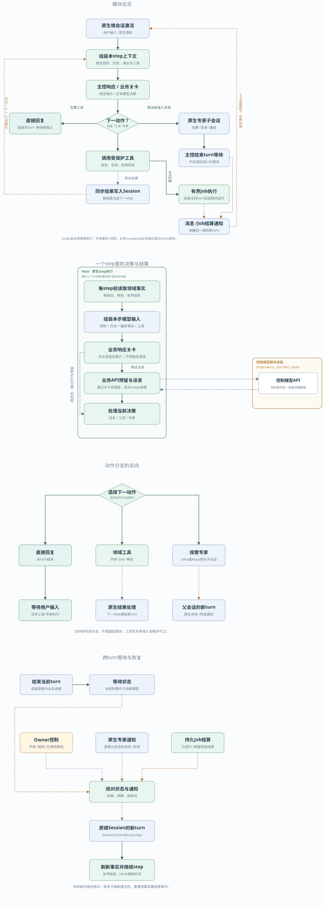

[打开完整SVG](architecture/loop.svg)

图内边界：

- Host · 原生step执行：事实/上下文/预算/模型客户端/动作处理
- 控制模型服务进程：原生客户端认证；响应不替代工具权限

- 业务意图模块确定当前需求范围；主控在范围内选择回复、澄清、领域工具或已准入专家。
- Loop、turn/step和原生子会话生命周期未重写；同输入多step复用决策。
- 模块内部的简单流程合并在同一图中，不再逐层点击；可全屏、缩放、导出查看完整关系。
- 范围关卡在原生llm/stream派发处短路：无关/不明确只产生固定程序回复，主控API不被调用；辅助分类仍按真实usage计量，历史上下文不以伪造零usage替代估算。
- 范围关卡先于主控API预算预留：固定流跳过API和预留，直接交由原生Loop处理回复；辅助分类API仍照常预留与结算。

协作模块：

- [上下文工程](#context)：每step怎样组装输入
- [工具系统](#tools_system)：工具怎样返回结果
- [主控与专家协作](#collaboration)：何时调用专家
- [权限、预算与状态守卫](#governance)：请求/工具执行的守卫

## 主控与专家协作

[项目总览](#system) → [主控与专家协作](#collaboration)

默认auto先由Pilot主控处理，按证据使用零位、一位或先后两位专家。

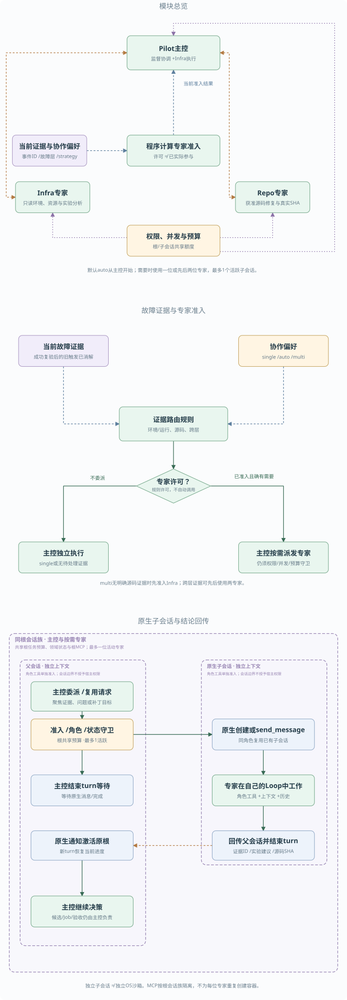

[打开完整SVG](architecture/collaboration.svg)

图内边界：

- 同根会话族 · 主控与按需专家：共享根任务预算、领域状态与根MCP；最多一位活动专家
- 父会话 · 独立上下文：角色工具单独准入；会话边界不授予宿主权限
- 原生子会话 · 独立上下文：角色工具单独准入；会话边界不授予宿主权限

- 主控承担监督协调与Infra执行；两位专家有不同作用域。
- 准入是许可，实际参与以原生子会话与工具轨迹为准。
- 模块内部的简单流程合并在同一图中，不再逐层点击；可全屏、缩放、导出查看完整关系。
- 专家继承主控当前已记录请求模型；新建/恢复不会被全局默认强制覆盖。不同模型的容量与推理等级由原生目录解析。

协作模块：

- [Agent Loop](#loop)：协作如何进入主控Loop
- [权限、预算与状态守卫](#governance)：角色、并发和预算约束

## 上下文工程

[项目总览](#system) → [上下文工程](#context)

区分稳定规则、近期历史、动态事实和工具Schema，再由原生运行时组装模型输入。

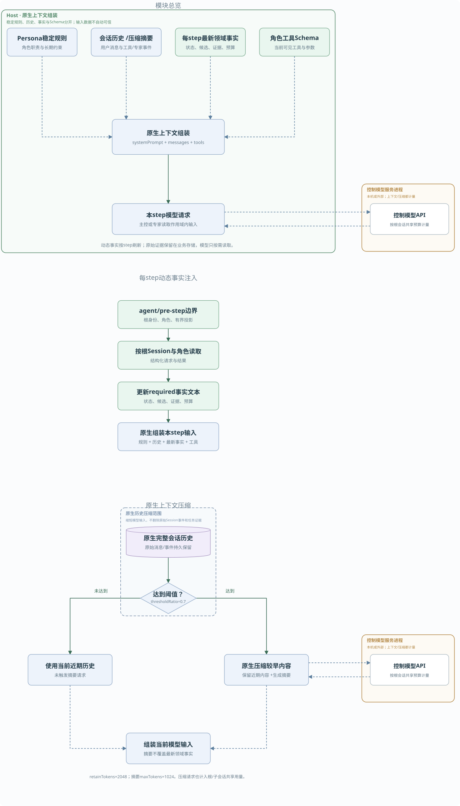

[打开完整SVG](architecture/context.svg)

图内边界：

- Host · 原生上下文组装：稳定规则、历史、事实与Schema分开；输入数据不自动可信
- 控制模型服务进程：本机或外部；上下文/压缩都计量
- 控制模型服务进程：本机或外部；上下文/压缩都计量
- 原生历史压缩范围：缩短模型输入，不删除原始Session事件和任务证据

- 这些是输入来源，不是顺序调用，所以用组成图表达。
- 最新业务事实优先于旧对话和压缩摘要；按需查询原始证据。
- 模块内部的简单流程合并在同一图中，不再逐层点击；可全屏、缩放、导出查看完整关系。
- 图片引用由原生AttachmentStore读取并投影到已选模型；计量、压缩和image/offload沿用原生，历史原图保留。
- 范围关卡在原生llm/stream派发处短路：无关/不明确只产生固定程序回复，主控API不被调用；辅助分类仍按真实usage计量，历史上下文不以伪造零usage替代估算。

协作模块：

- [Agent Loop](#loop)：输入在每step中的位置
- [记忆机制与业务状态](#memory)：事实来自哪些持久数据
- [工具系统](#tools_system)：模型能看见哪些角色工具

## 记忆机制与业务状态

[项目总览](#system) → [记忆机制与业务状态](#memory)

把对话记忆、业务进度和原始证据分开存储与使用。

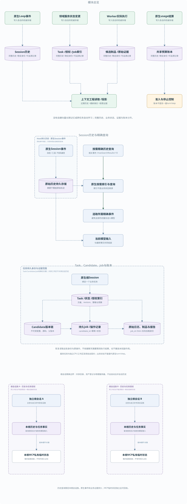

[打开完整SVG](architecture/memory.svg)

图内边界：

- Host持久历史 · 原生Session事件：原始事件保留；只按本根会话族授权查询
- 任务持久身份与证据范围：Task/Candidate/Job有确切归属；共享工作区不共享会话历史
- 根会话族 A · 历史与任务授权：同工作区也不能读取另一根会话族的历史
- 根会话族 B · 历史与任务授权：同工作区也不能读取另一根会话族的历史

- Session保存消息/turn/step；SQLite保存Task/授权/Job索引；文件保存候选制品与原始证据。
- 目前没有自建向量长期记忆或跨任务自动经验学习。
- 模块内部的简单流程合并在同一图中，不再逐层点击；可全屏、缩放、导出查看完整关系。
- stdio按根会话使用私有容器和原生客户端；MCP临时文件不是业务记忆。管理桥、构建与GPU容器、外部HTTP边界见权限模块。
- 图片附件和会话选模是原生持久事件/引用，冷恢复保留本会话选择；引用不是执行授权。

协作模块：

- [上下文工程](#context)：持久数据如何进入模型上下文
- [领域执行与独立交付](#execution)：候选与证据如何用于验收

## 工具系统

[项目总览](#system) → [工具系统](#tools_system)

本地领域工具、隔离stdio MCP、外部HTTP MCP和Skills各有明确调用路径；协议与内容投影沿用原生工具接口。

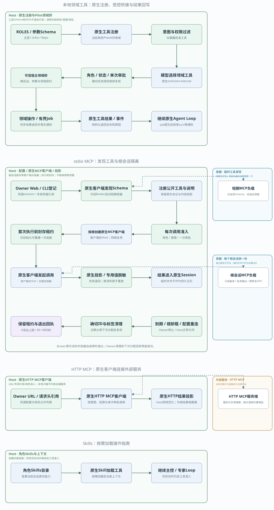

[打开完整SVG](architecture/tools_system.svg)

图内边界：

- Host · 原生注册与Pilot领域桥：工具Schema和Skills不是执行权；调用仍经角色/意图/审批
- Host · 配置 / 原生MCP客户端 / 投影：根会话族共享客户端与容器；执行前封存；不继承控制凭据
- 容器 · 临时工具发现：依赖已打包；初始化最多协商重建一次
- 容器 · 每个根会话族一份：独立根互不可见；临时文件不作为长期记忆
- Host · 原生HTTP MCP客户端：URL/专用引用/角色准入；本地沙箱不约束远端服务
- 外部服务 · HTTP MCP：资料范围不代表服务已证明只读
- Host · 角色Skills与上下文：加载的是指南；所有实际动作继续走工具准入

- 本地领域工具不是任意Shell；管理桥运行在宿主可信边界。
- 原生MCP客户端可在首次工具执行前重建一次stdio连接以协商协议，绝对租约不延长；执行前封存，之后禁止重建与自动重放。
- HTTP服务结果和Skills文本是数据或指令，不能替代Owner授权；容器临时状态不参与业务记忆持久化。
- 原生MCP客户端和内容投影在Host；容器只运行MCP服务端负载。HTTP客户端在Host，HTTP服务端属于外部依赖。
- 短期发现容器与根会话执行容器分开；4活动租约覆盖本地stdio与自检，不统计GPU与构建。

协作模块：

- [权限、预算与状态守卫](#governance)：工具调用前后的权限校验
- [Agent Loop](#loop)：工具返回如何继续step

## 权限、预算与状态守卫

[项目总览](#system) → [权限、预算与状态守卫](#governance)

权限和预算由程序实施，不能只依靠主控或专家的Prompt自律。

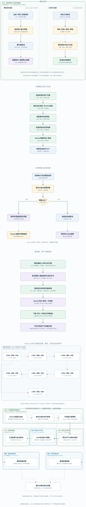

[打开完整SVG](architecture/governance.svg)

图内边界：

- Host · 请求预算与工具授权通道：预算是用量准入；Owner审批是动作授权；两者独立
- 配置协调范围 · Owner请求与Host保存：保存不等于生效；控制Key不进入会话、日志或容器
- Host · 可信管理与调用准入：结构化执行与身份核验；权限检查不在负载内实现
- Host · 原生MCP客户端：协议在Host；工作负载在容器
- Host · 原生结果投影：返回数据不授予执行权限
- 容器 · 根会话MCP负载：CPU/内存/PIDs/租约；禁网无GPU
- 容器 · 源码构建负载：独立构建限额；不计入MCP 0/4
- 容器 · 目标推理负载：按任务批准设备与限额；独立验收

- 观察整机不扩大执行配额；Owner批准也不能突破登记能力和上限。
- 模块内部的简单流程合并在同一图中，不再逐层点击；可全屏、缩放、导出查看完整关系。
- 范围关卡在原生llm/stream派发处短路：无关/不明确只产生固定程序回复，主控API不被调用；辅助分类仍按真实usage计量，历史上下文不以伪造零usage替代估算。

协作模块：

- [工具系统](#tools_system)：守卫保护哪些工具
- [主控与专家协作](#collaboration)：专家准入与并发约束
- [模型、图片与资源路径](#model_access)：每模型凭据、能力与受管资源路径

## 领域执行与独立交付

[项目总览](#system) → [领域执行与独立交付](#execution)

推理部署、受控诊断修复、比较/测试以及隔离CPU工作区由领域契约和确定性程序实施。

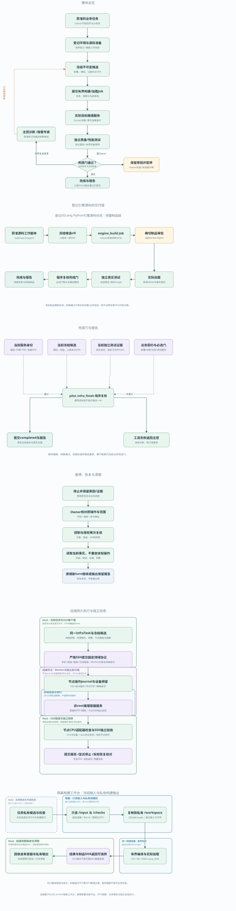

[打开完整SVG](architecture/execution.svg)

图内边界：

- Host · 冻结任务与SSH客户端：固定协议发往登记节点；SSH凭据留在Host
- 远端节点 · Worker与独立执行根：节点journal/设备预留/持久状态；与Host会话分开
- 远端容器与租约：GPU只按批准配额；不接管其他服务
- Host · SSH隧道与独立验收：读取远端实际结果；保留服务/候选/测试身份
- Host · 冻结候选与可信检查：源SHA与配方复核；只读提供输入
- 容器 · 只读输入与私有构建区：输入复制到tmpfs；非root/禁网无GPU
- 同一构建容器 · 有界执行：编译与加载不在Host运行
- Host · 结果和精确身份清理：可信桥保存日志/制品SHA；原始候选再次核验

- 控制模型负责决策，被测推理模型由Worker部署和测试，计量分开。
- 登记CPU执行器不存在时不能创建工作区；图不把规划当作已启用。
- 模块内部的简单流程合并在同一图中，不再逐层点击；可全屏、缩放、导出查看完整关系。
- stdio按根会话使用私有容器和原生客户端；MCP临时文件不是业务记忆。管理桥、构建与GPU容器、外部HTTP边界见权限模块。
- 模型下载采用节点asset_root/models/ID/revision并固定操作快照；改变默认目录只影响新的准备。Docker镜像层由节点daemon管理。

协作模块：

- [工具系统](#tools_system)：执行器如何通过Job接入Loop
- [记忆机制与业务状态](#memory)：候选、Job与证据身份
- [权限、预算与状态守卫](#governance)：执行范围来自哪些授权

## 组件与代码入口

### 用户输入

需求、追问与任务控制

- 新推理需求默认进入Pilot主控；已有任务回到原根会话。
- 对话输入、结构化方案和Owner按钮是不同入口；它们共用业务状态。

代码：[harness/runtime/plugins/infra-domain/client.js](../harness/runtime/plugins/infra-domain/client.js)；[harness/runtime/plugins/infra-domain/index.mjs](../harness/runtime/plugins/infra-domain/index.mjs)

### Web与原生会话

对话 / 表单 / 控制

- 对话写入原生Session，随后激活主控。
- 表单、开始/暂停/继续等Owner操作直接走领域RPC；不会先由模型改写成命令。
- 侧栏+和会话工作区选择器复用原生目录浏览→登记→连接空白Session；新会话继承当前目录并创建独立根。
- Host/Worker运行环境和依赖缓存由StorageLayout统一到项目数据盘，私有历史位置保持。
- 软件方案公开冻结节点/目录/镜像/设备与限额；准备只准备，Owner明确启动按钮通过官方SessionController.prompt回到原根。

代码：[harness/runtime/plugins/infra-domain/index.mjs](../harness/runtime/plugins/infra-domain/index.mjs)；[harness/runtime/plugins/workspace/index.mjs](../harness/runtime/plugins/workspace/index.mjs)；[src/pilot_core/storage.py](../src/pilot_core/storage.py)；[src/pilot_host/storage_cli.py](../src/pilot_host/storage_cli.py)；[src/pilot_core/storage_housekeeping.py](../src/pilot_core/storage_housekeeping.py)

### 原生根会话

消息、turn与step

- 一个任务绑定一个根Session，恢复沿用该身份。
- 原生事件记录消息、工具、专家通信和turn/step；业务running状态不等于会话正在推理。
- 原生持久图片引用和model-selection保存在Session事件；独立根不会继承对方图片，冷恢复沿用本会话选模。

代码：[src/pilot_host/cli.py](../src/pilot_host/cli.py)；[harness/runtime/plugins/workspace/index.mjs](../harness/runtime/plugins/workspace/index.mjs)

### Pilot主控

按需求范围选择下一动作

- 默认auto先由主控处理；模型理解当前输入并选择回复、工具或协作。
- 主控承担监督协调和Infra执行，冻结候选、提交Job、请求审批，并依据独立验收交付。
- 一个step可含多个工具；一项业务可跨多个turn。
- 明确任务缺少关键选项时可使用原生ask_user_question；无目标输入先简短对话澄清。

代码：[src/pilot_infra/presets.py](../src/pilot_infra/presets.py)；[src/pilot_host/cli.py](../src/pilot_host/cli.py)

当前领域工具：`pilot_infra_adapter_check`、`pilot_infra_asset_catalog`、`pilot_infra_asset_propose`、`pilot_infra_asset_request_prepare`、`pilot_infra_asset_status`、`pilot_infra_assets`、`pilot_infra_candidate`、`pilot_infra_compatibility_docs`、`pilot_infra_diagnose`、`pilot_infra_engine_build`、`pilot_infra_engine_request_approval`、`pilot_infra_engine_rollback`、`pilot_infra_engine_source_patch`、`pilot_infra_engine_source_prepare`、`pilot_infra_engine_source_read`、`pilot_infra_engine_source_search`、`pilot_infra_engine_source_status`、`pilot_infra_evidence`、`pilot_infra_finish`、`pilot_infra_launch`、`pilot_infra_model_metadata`、`pilot_infra_network_cleanup`、`pilot_infra_network_plan`、`pilot_infra_network_recommend`、`pilot_infra_network_status`、`pilot_infra_plan`、`pilot_infra_probe`、`pilot_infra_resource_assess`、`pilot_infra_resource_catalog`、`pilot_infra_resource_execute`、`pilot_infra_resource_observe`、`pilot_infra_resource_propose`、`pilot_infra_resource_request_approval`、`pilot_infra_resource_review`、`pilot_infra_revise`、`pilot_infra_source_read`、`pilot_infra_source_write`、`pilot_infra_stack_candidates`、`pilot_infra_stack_propose`、`pilot_infra_status`、`pilot_infra_strategy`、`pilot_infra_test`、`pilot_infra_workbench_cleanup`、`pilot_infra_workbench_freeze`、`pilot_infra_workbench_patch`、`pilot_infra_workbench_plan`、`pilot_infra_workbench_profiles`、`pilot_infra_workbench_read`、`pilot_infra_workbench_recommend`、`pilot_infra_workbench_run`、`pilot_infra_workbench_status`、`pilot_infra_workbench_write`

### 业务意图识别与路由

相关性 ·动作 ·工具范围

- 入口先区分业务相关、无关与不确定，再区分项目帮助、咨询、观察、规划、修订、执行和控制。
- 简单问候与w等输入规则快判；复杂输入经原生LLM辅助请求，同根归属和预算计量。
- 低置信度、缺少目标、无可核对变更请求时澄清；相关性不能授予权限或增加资源配额。
- 原生runtime-context保存带输入摘要的决策；同输入只分类一次，恢复可复用，用户真实答案触发重新判断。
- 有文字目标的图片输入走同一会话模型进行辅助分类；纯图片先澄清。图片中文字不属于执行授权，变更证据必须引用用户文本或实际回答。
- 分类正确不等于响应已受限；固定业务响应关卡让非业务与不确定输入不进入主控自由生成，分类用量仍归同根预算。

代码：[harness/runtime/plugins/intent-router/index.mjs](../harness/runtime/plugins/intent-router/index.mjs)；[harness/plugin/intent.mjs](../harness/plugin/intent.mjs)；[src/pilot_infra/intent_catalog.json](../src/pilot_infra/intent_catalog.json)；[harness/runtime/plugins/workspace/index.mjs](../harness/runtime/plugins/workspace/index.mjs)

### 专家准入规则

偏好 + 当前故障证据

- single不委派；auto基于当前环境/运行或源码证据准入对应专家。
- multi允许协作，无明确源码证据时先准入Infra；跨层可先后使用两者。
- 成功业务复验消解旧触发。准入只是许可，实际参与以原生子会话为准。

代码：[src/pilot_infra/routing.py](../src/pilot_infra/routing.py)；[src/pilot_infra/service.py](../src/pilot_infra/service.py)

### Infra专家

资源、环境、运行诊断

- 只读分析整机占用、依赖、服务日志和实验证据，提出区分实验。
- 可记录带真实事件ID的假设；不能修改源码或提交GPU Job。
- 通过原生消息把结论返回主控，结束自己的turn。

代码：[src/pilot_infra/presets.py](../src/pilot_infra/presets.py)；[src/pilot_infra/service.py](../src/pilot_infra/service.py)

当前领域工具：`pilot_infra_asset_catalog`、`pilot_infra_asset_status`、`pilot_infra_assets`、`pilot_infra_compatibility_docs`、`pilot_infra_diagnose`、`pilot_infra_engine_source_read`、`pilot_infra_engine_source_search`、`pilot_infra_engine_source_status`、`pilot_infra_evidence`、`pilot_infra_model_metadata`、`pilot_infra_network_recommend`、`pilot_infra_network_status`、`pilot_infra_probe`、`pilot_infra_resource_assess`、`pilot_infra_resource_catalog`、`pilot_infra_resource_observe`、`pilot_infra_resource_review`、`pilot_infra_source_read`、`pilot_infra_stack_candidates`、`pilot_infra_status`、`pilot_infra_strategy`、`pilot_infra_workbench_profiles`、`pilot_infra_workbench_read`、`pilot_infra_workbench_recommend`、`pilot_infra_workbench_status`

### Repo软件subagent

获准源码修复与SHA

- 软件任务可编写评测脚本、源码适配、profiling与固定算子候选；主控冻结、运行和汇总独立验证。

代码：[src/pilot_infra/presets.py](../src/pilot_infra/presets.py)；[src/pilot_infra/engine_source.py](../src/pilot_infra/engine_source.py)；[src/pilot_infra/software_templates.py](../src/pilot_infra/software_templates.py)；[src/pilot_infra/build_validation.py](../src/pilot_infra/build_validation.py)

当前领域工具：`pilot_infra_adapter_check`、`pilot_infra_asset_catalog`、`pilot_infra_asset_status`、`pilot_infra_assets`、`pilot_infra_compatibility_docs`、`pilot_infra_diagnose`、`pilot_infra_engine_source_patch`、`pilot_infra_engine_source_read`、`pilot_infra_engine_source_search`、`pilot_infra_engine_source_status`、`pilot_infra_evidence`、`pilot_infra_model_metadata`、`pilot_infra_network_recommend`、`pilot_infra_network_status`、`pilot_infra_probe`、`pilot_infra_resource_assess`、`pilot_infra_resource_catalog`、`pilot_infra_resource_observe`、`pilot_infra_resource_review`、`pilot_infra_source_read`、`pilot_infra_source_write`、`pilot_infra_stack_candidates`、`pilot_infra_status`、`pilot_infra_strategy`、`pilot_infra_workbench_patch`、`pilot_infra_workbench_profiles`、`pilot_infra_workbench_read`、`pilot_infra_workbench_recommend`、`pilot_infra_workbench_status`、`pilot_infra_workbench_write`

### 任务权限与配额

模型请求与工具的守卫

- 按assets/downloads/containers/software/network/inference/profiling准入，端口及GPU共享另外配置。
- Docker密码只在加密凭据库与SSH私有输入，任务与容器不保存；源码/网络恢复使用原快照。

代码：[harness/runtime/plugins/policy/index.mjs](../harness/runtime/plugins/policy/index.mjs)；[src/pilot_infra/resource_service.py](../src/pilot_infra/resource_service.py)；[harness/plugin/budget.mjs](../harness/plugin/budget.mjs)；[src/pilot_infra/node_authority.py](../src/pilot_infra/node_authority.py)；[src/pilot_infra/node_docker.py](../src/pilot_infra/node_docker.py)

### Owner审阅与控制

开始 / 继续 / 单次审批

- 方案保存不会执行；Owner明确开始或继续后激活原根会话。
- 资源方案及改变的确切引擎制品按条件请求单次审批。
- 用户可暂停、取消、调整预算或停止自有服务；推理与容器权限分别核验，撤销后仍可清理自有服务。
- Owner在工作区与模型设置中检查目录、测试连接、保存并在空闲时同步；Agent不能改此配置。

代码：[harness/runtime/plugins/infra-domain/index.mjs](../harness/runtime/plugins/infra-domain/index.mjs)；[src/pilot_infra/resource_service.py](../src/pilot_infra/resource_service.py)；[src/pilot_infra/service.py](../src/pilot_infra/service.py)

### 领域契约与状态机

方案、候选、Job和权限

- InfraPlan定义部署、诊断、比较和测试；跨机草稿使用单独的双节点契约和静态预检，尚不执行。
- 服务校验revision、幂等标识、登记资产、候选身份和任务授权。
- 业务SQLite和文件保存进度；它们不是另一份对话历史。

代码：[src/pilot_infra/contracts.py](../src/pilot_infra/contracts.py)；[src/pilot_infra/distributed_contracts.py](../src/pilot_infra/distributed_contracts.py)；[src/pilot_infra/distributed_recipes.py](../src/pilot_infra/distributed_recipes.py)；[src/pilot_infra/distributed_service.py](../src/pilot_infra/distributed_service.py)；[src/pilot_infra/service.py](../src/pilot_infra/service.py)；[src/pilot_infra/store.py](../src/pilot_infra/store.py)；[src/pilot_infra/build_service.py](../src/pilot_infra/build_service.py)

### 调用工具或提交Job

读写工具 / 构建 / 推理实验

- 观测、诊断、源码补丁、冻结等同步结果写入会话，通常继续下一个step；规划和审批等会结束turn，等待Owner。
- 构建/加载/测试等提交一个持久Job并结束当前turn，等待真实结算。
- 不叠加未结算副作用；任务内修复生成新候选。

代码：[src/pilot_infra/service.py](../src/pilot_infra/service.py)；[harness/runtime/plugins/workspace/index.mjs](../harness/runtime/plugins/workspace/index.mjs)

当前领域工具：`pilot_infra_assets`、`pilot_infra_probe`、`pilot_infra_plan`、`pilot_infra_revise`、`pilot_infra_diagnose`、`pilot_infra_candidate`、`pilot_infra_engine_source_patch`、`pilot_infra_engine_build`、`pilot_infra_launch`、`pilot_infra_test`、`pilot_infra_finish`

### 隔离Worker与服务

实际构建、加载、测试

- 确定性Worker执行固定OCI生命周期；新SGLang/vLLM部署必须Docker，无宿主进程兜底。
- 引擎源码经冻结、wheel构建、确切审批后加载；推理服务是被测模型。
- CPU工作区由主控单独执行；没有登记执行器时不提供创建入口。
- 固定镜像SHA、模型只读、非root、资源限制、授权GPU与私有网络；清理核对任务标签及容器ID。
- SGLang/vLLM分别校验后端选项与协议；旧vLLM镜像的NVML UUID兼容在固定镜像内实现。
- 交付复核使用实际任务限额和源码加载验收字段；手动与Agent变更按控制模式互斥。
- 请求取消、总时限、固定输入协议与候选比较由独立业务程序复核，原生Loop保持。

代码：[src/pilot_infra/worker.py](../src/pilot_infra/worker.py)；[src/pilot_infra/engine_source.py](../src/pilot_infra/engine_source.py)；[src/pilot_infra/process_engine.py](../src/pilot_infra/process_engine.py)；[src/pilot_infra/build_worker.py](../src/pilot_infra/build_worker.py)；[src/pilot_infra/container_runtime.py](../src/pilot_infra/container_runtime.py)；[src/pilot_infra/vllm_compat.py](../src/pilot_infra/vllm_compat.py)；[src/pilot_infra/inference_http.py](../src/pilot_infra/inference_http.py)；[src/pilot_infra/benchmark.py](../src/pilot_infra/benchmark.py)

### 持久结果与结算

日志、指标、身份、证据SHA

- Worker保存原始结果、日志、服务身份和证据摘要。
- 结算器只把Job引用通知原根会话；最新事实在下一步重新组装。
- 模型不通过反复生成turn轮询Job。失败和未知操作保留。

代码：[src/pilot_infra/worker.py](../src/pilot_infra/worker.py)；[src/pilot_infra/store.py](../src/pilot_infra/store.py)；[harness/runtime/plugins/infra-domain/index.mjs](../harness/runtime/plugins/infra-domain/index.mjs)

### 独立验收与交付

当前候选通过才能完成

- finish程序复核当前服务、候选、制品和测试文件身份，以及必选质量/性能门。
- 健康检查、构建成功或模型说完成都不能替代业务验收。
- 通过才保存completed和报告；未通过回到诊断、修复或暂停。
- 请求取消、总时限、固定输入协议与候选比较由独立业务程序复核，原生Loop保持。

代码：[src/pilot_infra/service.py](../src/pilot_infra/service.py)；[src/pilot_infra/engine.py](../src/pilot_infra/engine.py)；[src/pilot_infra/inference_http.py](../src/pilot_infra/inference_http.py)；[src/pilot_infra/benchmark.py](../src/pilot_infra/benchmark.py)

### 暂停、恢复或报告

保留原会话与业务进度

- 预算不足、权限失效、未交付或未知副作用分别保留原因。
- Owner继续后重读事实，复用同一任务/根会话；完成报告与停止服务是两个动作。

代码：[src/pilot_infra/service.py](../src/pilot_infra/service.py)；[harness/runtime/plugins/infra-domain/index.mjs](../harness/runtime/plugins/infra-domain/index.mjs)

### 稳定规则与角色

职责、工具范围、约束

- Persona与角色预设提供稳定指令；权限不是靠模型自我约束。
- 主控和专家各自拥有作用域内的工具，角色目录与实际注册保持一致。

代码：[src/pilot_infra/presets.py](../src/pilot_infra/presets.py)；[src/pilot_host/cli.py](../src/pilot_host/cli.py)

### 原生Session历史

精确事件查询 / 原始轨迹

- 原生Session持久化完整消息、工具、专家通信与压缩来源。
- Pilot薄插件复用原生历史Schema/查询/呈现，同时按原生parentSession验证同根家族；共享cwd不能访问别的根会话。
- 跨turn/冷恢复继承本会话；压缩不删除原始事件，专家可查询同根确切历史。
- 没有自建向量长期记忆或跨任务自动学习。

代码：[src/pilot_host/cli.py](../src/pilot_host/cli.py)；[harness/runtime/plugins/context/index.mjs](../harness/runtime/plugins/context/index.mjs)；[harness/runtime/plugins/history/index.mjs](../harness/runtime/plugins/history/index.mjs)

### 每步刷新当前事实

状态、候选、证据、预算

- context插件在每个step前从领域服务读取最新事实，再用原生上下文接口注入。
- 主控/专家采用有界投影；旧历史和压缩摘要不能覆盖当前任务事实。

代码：[harness/runtime/plugins/context/index.mjs](../harness/runtime/plugins/context/index.mjs)；[src/pilot_infra/service.py](../src/pilot_infra/service.py)

### 业务SQLite与账本

Task / 授权 / Job / 用量

- 保存业务状态、幂等操作、策略、授权和证据索引；预算账本结算原生usage。
- Task、Candidate、Job与Session是不同对象；业务状态不能替代turn/step。

代码：[src/pilot_infra/store.py](../src/pilot_infra/store.py)；[src/pilot_infra/resource_registry.py](../src/pilot_infra/resource_registry.py)；[harness/runtime/plugins/policy/index.mjs](../harness/runtime/plugins/policy/index.mjs)

### 候选与原始证据

版本、SHA、加载与验收

- 冻结源码/配置/父候选，构建制品与实际加载身份关联。
- 原始Job结果和日志在任务文件中保留，Web可读取；模型只按需读摘要或证据。

代码：[src/pilot_infra/engine_source.py](../src/pilot_infra/engine_source.py)；[src/pilot_infra/worker.py](../src/pilot_infra/worker.py)；[src/pilot_infra/service.py](../src/pilot_infra/service.py)

### 原生上下文压缩

保留近期内容与摘要

- 达到上下文阈值时压缩较早内容，完整原始历史仍持久保存。
- 压缩请求也计入共享用量；摘要不是业务验收或权限凭证。
- 输入框附近原生圆环来自contextPressure/contextBreakdown，显示当前上下文比例；压缩后更新，与累计预算分开。
- 图片走原生持久附件和路由尺寸投影；图片数量/字节超限按原生image/offload记录移出模型输入，原附件保留。摘要压缩不会凭空获得图片细节。
- 摘要路由使用原生最近请求模型（空summarization配置对），不固定全局apps连接；image/offload和原附件保留。
- 摘要上限按每个登记模型的窗口与输出上限计算；原生压缩拒绝不完整摘要，失败保留原模型和持久历史。

代码：[src/pilot_host/cli.py](../src/pilot_host/cli.py)；[harness/runtime/plugins/policy/index.mjs](../harness/runtime/plugins/policy/index.mjs)；[harness/runtime/plugins/brand/pilot.css](../harness/runtime/plugins/brand/pilot.css)；[src/pilot_host/compaction_policy.py](../src/pilot_host/compaction_policy.py)

### 组装本步模型输入

规则 + 历史 + 最新事实 + 工具

- 原生Loop组装模型输入，记录step边界并调度工具。
- 没有另一套自写LLM循环；Pilot插件提供业务事实、准入和工具适配。
- 按照当前会话模型组装文本与保留的图片引用；图片token由原生路由计量/估算，累计用量与窗口占用分开。

代码：[harness/runtime/plugins/context/index.mjs](../harness/runtime/plugins/context/index.mjs)；[harness/runtime/plugins/policy/index.mjs](../harness/runtime/plugins/policy/index.mjs)；[src/pilot_host/cli.py](../src/pilot_host/cli.py)

### 处理当前决策

回复 / 工具 / 专家

- 直接回复结束本turn；同步工具通常进入下一step。
- 提交Job、规划审阅或等待专家时结束当前turn，等待外部条件。
- 意图理解是主控的模型决策；工具与领域校验仍独立执行。

代码：[src/pilot_infra/presets.py](../src/pilot_infra/presets.py)；[harness/runtime/plugins/workspace/index.mjs](../harness/runtime/plugins/workspace/index.mjs)

### 原生结果回写

消息、工具结果与事件

- 模型输出与工具结果由原生运行时回写Session。
- 普通同步工具结果供后续step使用；规划、审批及Job按规则结束turn。
- 失败工具结果也是证据，不自动代表业务任务结束。

代码：[harness/runtime/plugins/workspace/index.mjs](../harness/runtime/plugins/workspace/index.mjs)；[src/pilot_host/cli.py](../src/pilot_host/cli.py)

### 下一step或结束turn

按当前动作与状态决定

- 同步结果允许同turn继续step；直接回复可结束该turn。
- 等待专家、Job或Owner时不持续模型轮询。
- 业务完成仍由finish程序验收，不能由模型回复代替。

代码：[harness/runtime/plugins/workspace/index.mjs](../harness/runtime/plugins/workspace/index.mjs)；[harness/runtime/plugins/infra-domain/index.mjs](../harness/runtime/plugins/infra-domain/index.mjs)

### 结束当前turn

保留根会话与执行进度

- 规划等待Owner Start；有界Job提交调用原生concludeTurn。
- 等待原生专家时主控结束自己的turn。
- 已用预算、候选与Job继续持久保存。

代码：[harness/runtime/plugins/workspace/index.mjs](../harness/runtime/plugins/workspace/index.mjs)；[src/pilot_infra/presets.py](../src/pilot_infra/presets.py)

### 符合条件的真实事件

专家 / Job / Owner

- 原生专家完成/通信、持久Job结算或Owner开始/继续可以唤醒。
- Job结算通知仅携带引用，完整原始结果保留。
- 审批、预算和未知副作用分别校验；不会仅靠定时生成模型turn。

代码：[harness/runtime/plugins/infra-domain/index.mjs](../harness/runtime/plugins/infra-domain/index.mjs)；[harness/runtime/plugins/policy/index.mjs](../harness/runtime/plugins/policy/index.mjs)

### 原根会话的新turn

恢复身份，不新建主控

- 原生通知或SessionController.prompt激活同一个根Session。
- 恢复时先读取当前事实，复用已冻结候选、已结算Job与专家历史。
- 未知副作用先核对，不能当作未执行重新提交。

代码：[harness/runtime/plugins/infra-domain/index.mjs](../harness/runtime/plugins/infra-domain/index.mjs)；[harness/runtime/plugins/workspace/index.mjs](../harness/runtime/plugins/workspace/index.mjs)

### 原生专家子会话

按准入创建或复用

- 主控使用infra_specialist/repo_specialist创建原生子会话。
- 同角色已有子会话可用send_message复用；最多一位活动专家，maxDepth=1。
- 根/子会话共享预算，创建与复用均受当前准入和权限校验。

代码：[src/pilot_host/cli.py](../src/pilot_host/cli.py)；[harness/runtime/plugins/policy/index.mjs](../harness/runtime/plugins/policy/index.mjs)

### 专家回传结论

证据ID / 实验建议 / 源码SHA

- Infra回传环境/运行证据及区分实验；Repo回传真实修改与SHA。
- 使用原生通信工具回传直接父会话并结束专家turn。
- 主控负责候选冻结、Job与最终交付，不能把专家建议当成验收。

代码：[src/pilot_infra/presets.py](../src/pilot_infra/presets.py)；[src/pilot_host/cli.py](../src/pilot_host/cli.py)

### 每step前读取领域事实

根身份、角色、有界投影

- context插件在agent/pre-step等待最新领域状态读取完成。
- 按根Session和角色读取有限事件、候选与Job；只在需要时读取完整证据。
- 动态事实刷新失败不能用陈旧摘要假装当前状态。

代码：[harness/runtime/plugins/context/index.mjs](../harness/runtime/plugins/context/index.mjs)；[src/pilot_infra/service.py](../src/pilot_infra/service.py)

### 角色工具注册与Schema

本地工具 / MCP / Skills

- presets.tools从实际ROLES生成领域工具及参数Schema。
- 原生defineTool注册，通过角色预设暴露工具；参数最终由领域契约再次校验。
- 领域工具、历史查询、专家通信是不同的工具族；不开放任意宿主Shell。
- 三个业务角色使用各自目录的原生Skill；Skill不授予执行权限。
- 设置工具系统读取所选原生会话实际Tools/Skill注册，不冒充未加载能力。
- Owner Web与CLI共用私有版本配置；原生MCP客户端管理stdio/HTTP连接、发现、重连和销毁。
- MCP工具保留原生Schema/输出/呈现，仅附加角色、业务意图、任务和一次审批；禁用旧工具立即拒绝，空闲后重载。
- MCP说明仅在本步准入该服务工具时进入系统上下文；销毁连接会移除对应说明，避免跨角色冗余。

代码：[src/pilot_infra/presets.py](../src/pilot_infra/presets.py)；[harness/runtime/plugins/workspace/index.mjs](../harness/runtime/plugins/workspace/index.mjs)；[src/pilot_host/cli.py](../src/pilot_host/cli.py)；[skills/infra-lead/coordinate-inference-delivery/SKILL.md](../skills/infra-lead/coordinate-inference-delivery/SKILL.md)；[src/repopilot/harness.py](../src/repopilot/harness.py)；[harness/runtime/plugins/tool-system/index.mjs](../harness/runtime/plugins/tool-system/index.mjs)；[harness/runtime/plugins/tool-system/config.mjs](../harness/runtime/plugins/tool-system/config.mjs)；[harness/runtime/plugins/tool-system/client.js](../harness/runtime/plugins/tool-system/client.js)；[src/pilot_host/tool_cli.py](../src/pilot_host/tool_cli.py)

### workspace工具适配

参数、根身份与turn控制

- 原生工具参数经薄插件转为领域操作，解析根会话及角色。
- 请求通过受限Python子进程；输出有字节上限与取消信号。
- 规划、Job、finish等按真实返回调用concludeTurn。

代码：[harness/runtime/plugins/workspace/index.mjs](../harness/runtime/plugins/workspace/index.mjs)

### Python领域桥接

结构化请求与结果

- pilot_host.bridge接收结构化JSON，派发对应领域服务。
- 业务错误作为工具失败返回；私有诊断/凭据不拼接到模型输出。
- Owner Web RPC与模型工具共用领域校验，入口授权不同。

代码：[src/pilot_host/bridge.py](../src/pilot_host/bridge.py)；[src/pilot_infra/service.py](../src/pilot_infra/service.py)

### 冻结资源方案

资产、设备、负载与上限

- 整机只读观测后分析容量/占用与登记兼容栈。
- 冻结完整服务器、模型/引擎、GPU/CPU/内存等配额，未知容量不能通过。
- 观测整机不是对所有设备的执行授权。

代码：[src/pilot_infra/resource_service.py](../src/pilot_infra/resource_service.py)；[src/pilot_infra/resource_contracts.py](../src/pilot_infra/resource_contracts.py)

### 绑定有界任务授权

会话、版本、期限与范围

- 审批结果绑定确切方案、根Session与任务身份。
- 排队/执行再次核对范围、期限与撤销；变更制品另有确切审批。
- 资源方案执行生成待开始草稿，Owner Start之后才运行。

代码：[src/pilot_infra/resource_service.py](../src/pilot_infra/resource_service.py)；[src/pilot_infra/resource_registry.py](../src/pilot_infra/resource_registry.py)

### 模型请求前预留

根/子会话共享累计预算

- 按原生token计量估计当前请求，预留输入与输出。
- 当前上限与累计用量按Owner设置，根/子会话共享，不自动追加。
- 压缩模型请求也参与用量结算。
- 主控固定范围回复不进入API预算预留；语义分类仍是独立的同根有界请求，原生step限额保持。

代码：[harness/plugin/budget.mjs](../harness/plugin/budget.mjs)；[harness/runtime/plugins/policy/index.mjs](../harness/runtime/plugins/policy/index.mjs)

### 原生流与响应关卡

业务调用或固定范围提示

- 由原生Loop发起并记录请求；Pilot范围关卡只处理主控的原生Loop请求，不修改冻结输入。
- 业务相关、专家与压缩请求通过原生适配器，记录真实usage；控制模型与目标推理服务分开统计。
- 业务无关与不确定仅返回固定原生流，不调用主控API、不编造provider usage；上下文仍沿原生估算。
- 会话及专家模型选择沿原生Session继承；设置同步只重映射被编辑的配置，不覆盖其他会话选择。

代码：[src/pilot_host/cli.py](../src/pilot_host/cli.py)；[harness/runtime/plugins/policy/index.mjs](../harness/runtime/plugins/policy/index.mjs)；[harness/runtime/plugins/intent-router/index.mjs](../harness/runtime/plugins/intent-router/index.mjs)

### 请求结算与准入更新

实际用量、停止原因与恢复

- 流结束按真实usage结算账本，保留累计使用。
- 不足时暂停并保存原因，Owner调整预算且明确继续才能恢复。
- 预算限制是项目准入策略，账本不是另一套turn/step。
- 辅助分类、原生压缩与专家共用根预算；累计预算不等于上下文窗口。
- 没有usage的请求采用保守预留并标记estimated；Web显示估算边界。

代码：[harness/plugin/budget.mjs](../harness/plugin/budget.mjs)；[harness/runtime/plugins/policy/index.mjs](../harness/runtime/plugins/policy/index.mjs)；[src/pilot_infra/service.py](../src/pilot_infra/service.py)

### 获准源码工作副本

adapter / 登记引擎源码

- 在授权任务的工作副本上读取并按预期SHA修改。
- 登记引擎支持受限SGLang Python源码，未知内核/驱动不在已验证范围。
- Repo可修副本，主控负责冻结与执行。

代码：[src/pilot_infra/engine_source.py](../src/pilot_infra/engine_source.py)；[src/pilot_infra/service.py](../src/pilot_infra/service.py)

当前领域工具：`pilot_infra_engine_source_read`、`pilot_infra_engine_source_search`、`pilot_infra_engine_source_patch`、`pilot_infra_source_read`、`pilot_infra_source_write`

### 冻结不可变候选

源码、配置、父版本与SHA

- 将受控工作副本冻结为新候选，保留失败与父版本。
- 任务中Candidate身份、制品和测试证据必须一致。
- 冻结后不覆盖历史候选。

代码：[src/pilot_infra/engine_source.py](../src/pilot_infra/engine_source.py)；[src/pilot_infra/store.py](../src/pilot_infra/store.py)

当前领域工具：`pilot_infra_candidate`

### 有界构建与制品

wheel / 离线安装 / SHA

- 登记源码候选提交engine_build Job，在无网络无GPU的Docker CPU容器中离线安装wheel。
- 保留确切构建日志、wheel与安装清单，构建通过不是推理验收。
- 任意构建命令、宿主驱动修复仍不开放。
- GPU服务实际加载审批制品；独立验收绑定容器ID/启动时间，退出或替换使验收失效。

代码：[src/pilot_infra/engine_source.py](../src/pilot_infra/engine_source.py)；[src/pilot_infra/worker.py](../src/pilot_infra/worker.py)

当前领域工具：`pilot_infra_engine_build`

### 确切制品审阅

当前候选与review digest

- 构建后通过原生单次审批审阅确切制品。
- 改变候选、制品或审批摘要后旧批准不能复用。
- 主控和专家都不能替Owner批准。

代码：[src/pilot_infra/engine_source.py](../src/pilot_infra/engine_source.py)；[harness/runtime/plugins/workspace/index.mjs](../harness/runtime/plugins/workspace/index.mjs)

当前领域工具：`pilot_infra_engine_request_approval`

### 实际加载与独立测试

自有进程 / 身份 / 真实请求

- 加载获准制品到任务自有服务，测试实际加载的版本和模型。
- 质量冒烟与有界性能矩阵由确定性执行器记录，包含失败分母。
- 服务健康、历史通过或同候选重启都不能替代当前验收。

代码：[src/pilot_infra/process_engine.py](../src/pilot_infra/process_engine.py)；[src/pilot_infra/engine.py](../src/pilot_infra/engine.py)；[src/pilot_infra/worker.py](../src/pilot_infra/worker.py)

当前领域工具：`pilot_infra_launch`、`pilot_infra_test`

### 完成状态与交付报告

当前验收结果与原始证据

- 只有finish程序通过当前候选与必选门槛，才保存completed和报告。
- 报告绑定候选/服务/证据；停止自有服务是独立Owner操作。
- 未通过继续诊断、生成受控新候选，或保留原因暂停。

代码：[src/pilot_infra/service.py](../src/pilot_infra/service.py)；[harness/runtime/plugins/infra-domain/client.js](../harness/runtime/plugins/infra-domain/client.js)

### 原生角色工具

按角色暴露的领域能力

- 领域工具在预设装配时注册并按角色暴露，调用经过参数和权限校验。
- 同步结果回写原生Session；规划、审批与Job按实际返回结束turn。
- Owner RPC共用领域服务，入口授权不同；不需要由模型改写成命令。
- 保存方案类工具按当前用户请求条件激活；执行前的单调守卫再次拒绝无明确请求的调用。

代码：[src/pilot_infra/presets.py](../src/pilot_infra/presets.py)；[harness/runtime/plugins/workspace/index.mjs](../harness/runtime/plugins/workspace/index.mjs)

### 直接回复

本turn结束，等待新输入

- 业务相关咨询可以直接回答；非业务只收到固定范围提示，不识别、转录、解题或展开其内容。
- 回复结束只表示这一turn结束；业务交付必须通过finish程序验收。

代码：[src/pilot_host/cli.py](../src/pilot_host/cli.py)；[src/pilot_infra/presets.py](../src/pilot_infra/presets.py)

### 可信输入与决策缓存

用户原话 ·真实答案 ·摘要锚点

- 原生user/message是请求来源；日志、代码、工具结果和模型建议不是授权。
- 同turn优先处理实际用户输入；自有控制与结算通知沿已授权任务继续。
- 输入与目录hash生成锚点，原生runtime-context保存结果；不改写聊天文件。
- 最近三条原生用户请求提供省略对象的上下文；旧目标不能覆盖当前无关、咨询或禁止变更请求。

代码：[harness/runtime/plugins/intent-router/index.mjs](../harness/runtime/plugins/intent-router/index.mjs)；[harness/runtime/plugins/workspace/index.mjs](../harness/runtime/plugins/workspace/index.mjs)

### 动作范围与执行准入

条件工具 ·单调guard ·后端复核

- 领域工具通过官方异步when按动作开放；原生协作/查询工具保留安装作用域，执行时由guard拒绝越界。
- 新规划仅无任务且明确请求；修订仅待开始方案；执行仅running或prepared。
- Owner控制走现有手动入口；角色、审批、配额、方案hash和后端状态校验继续独立执行。

代码：[harness/runtime/plugins/intent-router/index.mjs](../harness/runtime/plugins/intent-router/index.mjs)；[harness/runtime/plugins/policy/index.mjs](../harness/runtime/plugins/policy/index.mjs)；[harness/runtime/plugins/workspace/index.mjs](../harness/runtime/plugins/workspace/index.mjs)；[src/pilot_infra/service.py](../src/pilot_infra/service.py)

### 节点模型、镜像与容器

Owner登记逻辑名、固定来源、大小上限与目标服务器；下载/导入核验完成后才投影为可选资产。

- 逻辑版本聚合多节点实际位置；远端解析版本/下载，固定检查模型清单。
- 外部Docker镜像/容器仅查看或只读导入，自有容器按任务确切身份管理。

代码：[src/pilot_infra/asset_service.py](../src/pilot_infra/asset_service.py)；[src/pilot_infra/fleet_contracts.py](../src/pilot_infra/fleet_contracts.py)；[src/pilot_infra/docker_inventory.py](../src/pilot_infra/docker_inventory.py)

当前领域工具：`pilot_infra_asset_catalog`

### 厂商兼容栈选择

按硬件平台、CPU架构、驱动、模型类型/量化、能力与镜像依赖筛选带来源的支持配方。

- 按硬件平台、CPU架构、驱动、模型类型/量化、能力与镜像依赖筛选带来源的支持配方。
- 匹配不表示已运行；当前真实验收证据与声明支持分开。
- 配方平台/CPU/驱动/model_type/量化/能力硬筛，未知项不准入。
- 同类质量与身份验收证据用于候选排序，资料声明和CPU核验不能成为GPU通过。

代码：[src/pilot_infra/stack_catalog.py](../src/pilot_infra/stack_catalog.py)；[src/pilot_infra/fleet_contracts.py](../src/pilot_infra/fleet_contracts.py)

当前领域工具：`pilot_infra_stack_candidates`

### 节点持久资产准备

固定模型revision/OCI摘要，节点内下载/导入，核验内容、大小和CPU镜像环境。

- 固定模型revision/OCI摘要，节点内下载/导入，核验内容、大小和CPU镜像环境。
- Source和额度经Owner或原生一次审批；断连保存原operation，不自动重放未知副作用。
- 模型下载到节点资源根/models/资产ID/revision；操作记录留在执行根/operations。外置受管资产不随执行器清理删除。
- Owner先只读核验数据盘、目录所有权、Docker与硬件身份，再准备固定Worker；创建前复核挂载设备，重复硬件身份禁止独立分配配额。

代码：[src/pilot_infra/fleet_worker.py](../src/pilot_infra/fleet_worker.py)；[src/pilot_infra/asset_service.py](../src/pilot_infra/asset_service.py)

当前领域工具：`pilot_infra_asset_request_prepare`、`pilot_infra_asset_status`

### 节点执行器与SSH通道

服务器与权限配置严格SSH/跳板与专属执行根；机器身份、Worker摘要和接入版本绑定。

- 服务器与权限配置严格SSH/跳板与专属执行根；机器身份、Worker摘要和接入版本绑定；GPU进程占用未知不能准入。
- 固定标准库领域协议，不复制Agent Loop或暴露任意宿主Shell。

代码：[src/pilot_infra/fleet_transport.py](../src/pilot_infra/fleet_transport.py)；[src/pilot_infra/resource_transport.py](../src/pilot_infra/resource_transport.py)

### 远端容器服务与租约

节点journal先记录真实操作/容器/启动身份，获准设备与Docker隔离后启动。

- 节点journal先记录真实操作/容器/启动身份，获准设备与Docker隔离后启动。
- SSH断开不等于服务退出；租约守护及按身份停止自有容器，不操作共享服务。
- 启动与补偿停止使用不同持久操作ID；重查原日志，恢复复用原期限和输入，不重放未知副作用。
- 容器PID1执行绝对租约；节点守护PID/启动时刻/boot可核验。守护失效拒绝验收，PID1仍到期退出。
- 逐项核对私有网络、环境、后端、只读模型、资源、确切设备与标签/容器ID；只清理身份相符的自有资源。
- 新执行器绑定machine-id与可读硬件UUID，防止克隆系统身份混淆；每次请求核验数据盘设备。CPU沙箱无网络/设备、非root、限时与限额，清理仅认领本操作容器。

代码：[src/pilot_infra/fleet_worker.py](../src/pilot_infra/fleet_worker.py)；[src/pilot_infra/remote_engine.py](../src/pilot_infra/remote_engine.py)

当前领域工具：`pilot_infra_launch`

### 远端独立验收与恢复

Host通过短期SSH转发访问节点私有桥接接口并映射到本机回环地址，沿原质量/负载协议验收并绑定当前节点/容器/制品。

- Host通过短期SSH转发访问节点私有桥接接口并映射到本机回环地址，沿原质量/负载协议验收并绑定当前节点/容器/制品。
- 完成、停止、未知状态核对分别记录，旧通过或重新贴标签不能代替重新验收。
- 远端adapter检查使用同节点固定镜像的runc CPU沙箱、持久操作ID和冻结输入，Host重校验输出；Windows主控不依赖本地Docker。

代码：[src/pilot_infra/remote_engine.py](../src/pilot_infra/remote_engine.py)；[src/pilot_infra/worker.py](../src/pilot_infra/worker.py)；[src/pilot_infra/service.py](../src/pilot_infra/service.py)

当前领域工具：`pilot_infra_test`、`pilot_infra_finish`

### 原生目录浏览与工作区

浏览 / 新建 / 选择 / 原生登记

- 原生WorkspacePickFlow与DirectoryBrowser拥有弹窗、取消、加载和错误交互。
- PilotDirectoryPicker复用原生browse；主目录由已应用设置决定，旧登记目录保留访问，拒绝符号链接与越界。
- 原生WorkspaceRegistry登记已存在目录；SessionController创建/绑定会话，目录创建不会激活LLM。
- 此前UUID目录和创建回执兼容保留；新Web不使用原管理页或UUID命名创建。

代码：[harness/runtime/plugins/workspace/directory-picker.mjs](../harness/runtime/plugins/workspace/directory-picker.mjs)；[src/pilot_host/cli.py](../src/pilot_host/cli.py)；[src/pilot_host/workspace_cli.py](../src/pilot_host/workspace_cli.py)；[harness/runtime/plugins/infra-domain/client.js](../harness/runtime/plugins/infra-domain/client.js)；[harness/runtime/plugins/host-settings/config.mjs](../harness/runtime/plugins/host-settings/config.mjs)

### 工作区、模型与资源设置

Owner保存 /连接测试 /同步

- Owner Web/CLI同一版本化desired/applied协调器；工作区根、资源根和多模型目录分别保存、空闲同步。
- 每个稳定模型配置ID映射独立原生provider/API Key/图片能力/容量；旧单模型无损迁移为apps。
- 输入框复用原生选模，选择写入本会话；Pilot薄适配将全局默认持久化限制为设置操作，专家按原生已记录请求继承。
- 主控本机资源默认项目resources；服务器资源路径在节点单独核验和登记，已有位置保持，Docker存储由daemon管理。

代码：[harness/runtime/plugins/host-settings/index.mjs](../harness/runtime/plugins/host-settings/index.mjs)；[harness/runtime/plugins/host-settings/config.mjs](../harness/runtime/plugins/host-settings/config.mjs)；[harness/runtime/plugins/host-settings/client.js](../harness/runtime/plugins/host-settings/client.js)；[src/pilot_core/config.py](../src/pilot_core/config.py)；[src/pilot_host/settings_cli.py](../src/pilot_host/settings_cli.py)；[src/pilot_core/resource_paths.py](../src/pilot_core/resource_paths.py)；[src/pilot_infra/fleet_contracts.py](../src/pilot_infra/fleet_contracts.py)

### 执行隔离与租约

可信桥 / 根会话容器

- 管理桥在宿主可信边界运行结构化操作，代码负载进入容器，不改变原生Loop。
- stdio复用原生MCP客户端/createScope：短期发现Schema，按根会话运行；主控/专家同根复用，其他根隔离。
- 非root/禁网/无GPU/只读根与输入；私有tmpfs及CPU/RAM/PIDs限额，超时、取消、卸载与确切身份清理。
- 专用MCP凭据、独立askpass认证；不挂控制目录或Docker socket，不把密码放协议stdin。
- 源码构建只读输入/检查和256MiB构建区；推理使用已批准GPU与独立验收。HTTP MCP服务端为外部信任边界。
- 初始化阶段允许原生协议协商重建一次transport；首次工具执行前封存，绝对期限不重置。
- 旧transport携带代次身份；不能停止新代次。校验失败精确回收自有容器；自检随配置版本失效。

代码：[src/pilot_core/execution_sandbox.py](../src/pilot_core/execution_sandbox.py)；[src/pilot_core/sandbox_stdio.py](../src/pilot_core/sandbox_stdio.py)；[src/pilot_core/sandbox_askpass.py](../src/pilot_core/sandbox_askpass.py)；[harness/runtime/plugins/execution-sandbox/index.mjs](../harness/runtime/plugins/execution-sandbox/index.mjs)；[harness/runtime/plugins/tool-system/index.mjs](../harness/runtime/plugins/tool-system/index.mjs)；[src/pilot_infra/build_worker.py](../src/pilot_infra/build_worker.py)

### 控制模型API

本机服务或外部提供商

- 所有主控/专家的模型请求由原生客户端发起；API可在本机或外部。
- 控制模型生成的是决策数据，不能代替工具授权或目标模型验收。
- 控制模型用量与被部署模型的质量/性能评测分开。
- 按当前Session选择的原生provider发送文本或图片；不自动向其他供应商转发。图片输入支持PNG/JPEG/WebP/GIF，不等于音视频处理或图片生成。

代码：[src/pilot_host/cli.py](../src/pilot_host/cli.py)；[src/pilot_core/model_protocol.py](../src/pilot_core/model_protocol.py)

### 外部HTTP MCP

外部服务信任边界

- 原生HTTP客户端和投影在Host，服务端在外部服务边界。
- 所有者的角色/范围配置和每次审批不证明服务端已隔离。

代码：[harness/runtime/plugins/tool-system/index.mjs](../harness/runtime/plugins/tool-system/index.mjs)；[harness/runtime/plugins/tool-system/config.mjs](../harness/runtime/plugins/tool-system/config.mjs)

### 节点软件与网络Worker

原生MCP客户端 / 结构化领域桥

- 软件与网络共用服务器登记、节点执行根和冻结身份。
- 软件配方分开呈现脚本、编译、profiling、GPU数值/性能和同机PD调试验证；不以登记或回归数量替代业务成绩。
- 完整候选源码分块校验后归档到Host数据目录；运行和清理先校验，清理后仍可下载，历史无归档不伪造。

代码：[harness/runtime/plugins/tool-system/index.mjs](../harness/runtime/plugins/tool-system/index.mjs)；[harness/runtime/plugins/workspace/index.mjs](../harness/runtime/plugins/workspace/index.mjs)；[src/pilot_host/bridge.py](../src/pilot_host/bridge.py)；[src/pilot_core/execution_sandbox.py](../src/pilot_core/execution_sandbox.py)；[src/pilot_infra/registered_workbench.py](../src/pilot_infra/registered_workbench.py)；[src/pilot_infra/network_service.py](../src/pilot_infra/network_service.py)；[src/pilot_infra/network_worker.py](../src/pilot_infra/network_worker.py)；[src/pilot_infra/pd_template.py](../src/pilot_infra/pd_template.py)；[src/pilot_infra/build_service.py](../src/pilot_infra/build_service.py)；[src/pilot_infra/source_archive.py](../src/pilot_infra/source_archive.py)

### 原生图片准入与保存

校验、归一化与持久引用

- 原生SessionController检查模型图片能力后，AttachmentStore校验格式/尺寸/批次/字节并归一化；任何图片失败拒绝整条输入。
- Session只保存图片引用与元数据，base64/供应商URL不进入持久事件；模型请求阶段读取、校验、调整路由尺寸。
- 附件是待分析数据，不授予服务器、工具或执行权限；保留原生持久化和压缩机制。

代码：[src/pilot_host/cli.py](../src/pilot_host/cli.py)；[harness/runtime/plugins/host-settings/config.mjs](../harness/runtime/plugins/host-settings/config.mjs)；[harness/runtime/plugins/intent-router/index.mjs](../harness/runtime/plugins/intent-router/index.mjs)

### 受管下载与资源目录

默认路径、节点覆盖、操作快照

- Host默认resources/{models,sources,cache,exports}仅属于主控；远端按真实Linux挂载推荐pilot-data专属目录，分别登记执行根和asset_root。
- 新下载从生效设置或节点执行器获取资源根，记录确定目录；修改设置不移动已有任务/资产。
- 目录必须为专属空目录或本项目所有权标记目录；无符号链接、拒绝系统/控制/代码目录覆盖。
- OCI镜像层由目标节点Docker管理；更改资源根不修改Docker data-root、驱动或共享服务。源码工作副本和运行输出仍按获准任务工作区隔离。

代码：[src/pilot_core/resource_paths.py](../src/pilot_core/resource_paths.py)；[src/pilot_infra/fleet_worker.py](../src/pilot_infra/fleet_worker.py)；[src/pilot_infra/asset_service.py](../src/pilot_infra/asset_service.py)；[src/pilot_infra/node_storage.py](../src/pilot_infra/node_storage.py)

### 业务响应关卡

固定范围提示或业务澄清

- 复用原生llm/stream waterfall的短路能力，按输入锚点和已判定范围返回标准流式块；不改Loop或冻结请求。
- 业务外只提示范围，目标不明只澄清；没有主控适配器请求、工具调用、专家派发或业务状态修改。
- 辅助分类、原生压缩、已授权专家及其他应用保持原路径；复杂分类照常计量，固定程序提示不编造API usage。
- 原生Loop保存用户输入、固定回复和turn/step结束，Web与CLI读取同一会话；下一条业务输入重新准入。

代码：[harness/runtime/plugins/intent-router/index.mjs](../harness/runtime/plugins/intent-router/index.mjs)；[harness/runtime/plugins/context/index.mjs](../harness/runtime/plugins/context/index.mjs)

## 当前边界

- 控制模型负责决策，目标推理模型由Worker部署和测试；两者的用量与成绩分开。
- 独立CPU工作区目前由主控执行；没有登记执行器时不能创建。历史应用保留兼容入口。
- 复用原生Loop、Session、子会话、历史查询与压缩；业务意图识别是同一主控的薄插件，规则快判或同模型辅助请求，不增加独立Agent或向量记忆。
- 完整MMLU、任意GPU内核、持久跨机推理和多硬件验证仍需对应实现与实测，图不把规划当已实现。
- MCP初始化核验不是持续连接健康；工具页只投影实际会话注册，外部MCP不能替代受控资源和容器配方。
- 侧栏“历史记录”组合只读历史评测与历史应用，使用原生keyed child slot复用组件；历史应用的可选试用仍核验绑定服务身份。设置只保留配置、使用说明与架构入口。
- 节点级模型/镜像和厂商支持配方可由Owner登记，准备完成再投影为部署资产；实际平台验收、连接与登记分开。
- 远端标准库Worker经严格SSH通道执行Docker领域动作，原生Harness继续管理Loop/Session/上下文/专家；未完成实机的平台不能标为已验证。
- 可信管理桥负责受控宿主动作；stdio MCP与构建负载使用Docker容器，共享宿主内核；不声明微虚拟机级隔离。
- MCP工作区为有界只读副本，私有输出不自动写回；HTTP MCP服务端隔离由提供方负责。
- Host可信程序边界不是整机范围；同机容器与本机模型API仍为独立负载/服务进程。
- 根/子会话属于上下文与授权范围，不是OS沙箱；同根共享任务预算/MCP，独立根隔离历史及临时状态。
- 图片能力明确声明，模型请求按会话选择路由，不能静默丢图或自动换供应商。语义路由的图片不属于用户授权。
- 受管资源根仅控制Pilot资源文件，不能用设置迁移共享Docker data-root或宿主驱动。外置资源清理需独立资产决策，执行器清理只按原根操作。
